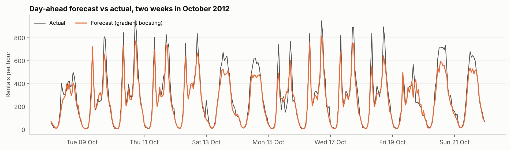

# Bike-Sharing Demand Forecasting: Day-Ahead Hourly Forecasts for Fleet Rebalancing

**A time-series machine-learning model that forecasts every hour of tomorrow's bike rentals, with a calibrated P90 upper bound for safety stock. It cuts forecast error by a third compared with the seasonal baseline.**

`Python` · `scikit-learn (HistGradientBoosting, Poisson & quantile loss)` · `Time-series cross-validation` · `Feature engineering` · `Conformal prediction`

---

## Business problem

Capital Bikeshare (Washington D.C.) moves bikes between stations by truck and schedules staff a day ahead. Each evening the operations team needs **hourly demand for the next day**, plus a safe upper bound so stations don't run empty at the commuter peaks.

## Data

[UCI Bike Sharing dataset](https://archive.ics.uci.edu/dataset/275/bike+sharing+dataset): 17,379 hourly records, Jan 2011 – Dec 2012, with rentals, calendar and weather. 165 hours are missing; lags are looked up by timestamp, so missing hours become missing values instead of shifting the series.

## Approach

| Step | Details |
|---|---|
| Forecast setting | **Day-ahead:** every demand feature is at least 24 hours old, so the model could run at midnight |
| Features | Hour, weekday, working day, holiday, month, season, weather; demand 24h / 48h / 168h ago, same-hour 7-day mean, yesterday's total |
| Split | Train Jan 2011 – Aug 2012; **test Sep – Dec 2012** (time-ordered, never shuffled) |
| Baselines | Seasonal naive (same hour last week); hour × day-type average |
| Models | Ridge regression (one-hot calendar) and **gradient boosting with Poisson loss** (suited to count data) |
| Tuning | `GridSearchCV` with **`TimeSeriesSplit`** (rolling origin, 4 × 30-day folds), so tuning never sees the future |
| Uncertainty | P90 quantile model, then **conformal calibration** on a held-out block to guarantee coverage |

## Results (test set, Sep – Dec 2012, 2,888 hours)

| Model | MAE (bikes/hour) | WAPE | R² |
|---|---|---|---|
| Hour × day-type average | 94.0 | 39.1% | 0.601 |
| Gradient boosting, no lag features | 88.0 | 36.7% | 0.663 |
| Seasonal naive (same hour last week) | 68.2 | 28.4% | 0.717 |
| Ridge regression | 60.2 | 25.1% | 0.826 |
| **Gradient boosting (Poisson)** | **46.2** | **19.2%** | **0.891** |



- **32% lower MAE** than the seasonal-naive baseline that a team could use with no model.
- **Lag features are essential.** Without them, error nearly doubles (36.7% WAPE): rentals grew 65% from 2011 to 2012, and tree models cannot extrapolate a trend from calendar and weather alone.
- **Commuter peaks** (8am, 5–6pm on working days): average demand 644/hour, model MAE 124 vs 149 for the naive baseline.
- Most important features (permutation importance): same-hour 7-day mean, hour of day, working day, temperature.

## Safety stock: a P90 bound you can trust

| P90 model | Test coverage (target 90%) |
|---|---|
| Raw quantile gradient boosting | 78.7%, under-covers because demand kept rising in late 2012 |
| **After conformal calibration** (Jul–Aug 2012 held out) | **90.4%** |

The calibrated bound adds about 96 bikes/hour above the point forecast on average. This is the buffer operations should plan trucks and dock space around.

## Repository structure

```
├── data/download_data.py
├── notebooks/01_demand_forecasting.ipynb
├── models/demand_models.joblib       # point model + P90 model + conformal adjustment
├── reports/figures/
└── src/style.py
```

## How to run

```bash
pip install -r requirements.txt
python data/download_data.py
jupyter notebook notebooks/01_demand_forecasting.ipynb
```

## Limitations and next steps

- Weather features use observed weather. In production they would be replaced by the previous evening's weather forecast, which adds some error.
- The model forecasts system-wide demand. Station-level forecasts would be the next step for the rebalancing routes themselves.
